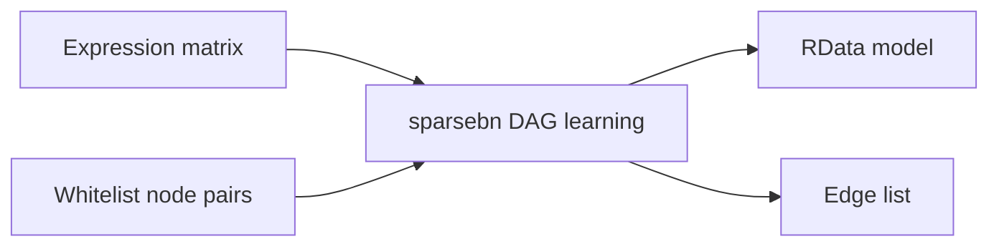

# Bayesian network construction

A Nextflow DSL2 entry point for the repository's sparsebn analysis. It accepts the expression matrix and two-column whitelist as inputs, stages them under the legacy filenames expected by `sparsebn.R`, and publishes the RData model and edge table. The existing bnlearn scripts remain available as standalone analyses.

## Quick start

Check workflow wiring with the included test profile:

```bash
nextflow run . -profile test -stub
```

Run sparsebn on your data:

```bash
nextflow run . -profile conda \
  --expression filtered_rpkm.txt \
  --whitelist whitelist.tsv \
  --outdir results
```

The expression table should be tab-delimited with variable names in its header and observations in rows. The whitelist is a tab-delimited two-column list of allowed node pairs. The R script currently selects observation rows 7, 8, 11, 12, 15, and 16; provide at least 16 rows in the expected order.

## Workflow



## Configuration

`nextflow.config` sets process resources and the output directory. Use `-profile conda` or `-profile docker`. The package environment is defined in `environment.yml`. A stub-only test profile and GitHub Actions workflow check workflow wiring without running the expensive statistical analysis.

## License

MIT. See [licence.txt](licence.txt).
